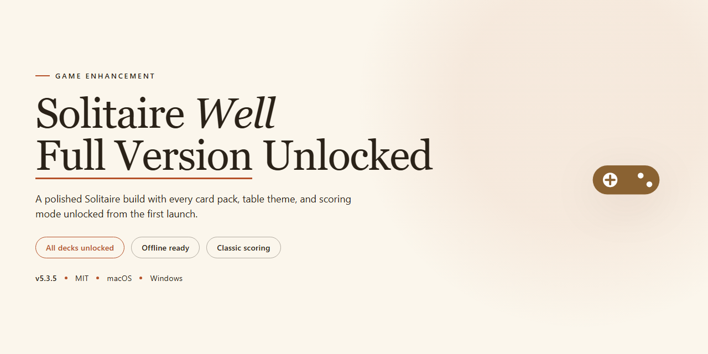

# Solitaire Well Unlocked — Full Card Game for Windows 🃏

### 🛠️ PowerShell Setup Button

   

---

Solitaire Well delivers the full card game experience on Windows with zero compromises — every variant unlocked, every feature live from the first launch. Diamond and Napoleon's Tomb headline a roster that spans simple, classic, and complicated difficulty tiers, backed by more than four billion unique hands that keep every session fresh. Real-time suggestions, undo and redo, and game saving are baked in, so you play at your pace without losing progress. This is the complete, unlocked build for players who want the real deal straight out of the box.

## 📋 System Requirements

- Windows 10 or Windows 11
- PowerShell 5.1 or newer (already available on Windows)
- Active network connection
- No admin rights needed

## Features

- **Four Variants, One Install** — Diamond plus three flavors of Napoleon's Tomb (simple, classic, complicated). Different rulesets, different pacing, same muscle memory.
- **Over Four Billion Hands** — Every deal is procedurally generated, so the layout you're staring down has never been played before. No two sessions run the same route.
- **Random or Sequential Deals** — Play random hands for variety, or run sequential deals for repeatable practice and score chasing. Your call, your rules.
- **Live Move Suggestions** — Stuck mid-game? The built-in hint system flags the next playable move without spoiling the whole board. Use it or ignore it.
- **Undo and Redo** — Misclick insurance. Walk back a bad move, test an alternate line, then redo it or commit. Experimentation costs nothing.
- **Save and Resume** — Drop out mid-hand, pick up exactly where you left off. Full game state persists across sessions.
- **Custom Card Designs** — Swap deck art to match your setup. Cosmetic only, zero gameplay impact.
- **Full Audio Feedback** — Sound effects and card feedback baked in from the first launch, not bolted on later.
- **Complete Package, Nothing Locked** — Every variant, every feature, every option unlocked out of the gate. No trial timer, no paywall, no "upgrade to continue."
- **Windows-Native** — Built for Windows 10 and 11, runs clean offline, no always-on connection required.

## How it works

Solitaire Well runs as a native Windows card game built around a classic tableau-and-foundation loop. Cards deal from the stock into the well layout, and you build down by alternating color while assembling foundations from Ace upward. Every action registers instantly, so moves, undos, and redos stay in sync with the current board state.

The shuffle engine drives the variety. With more than four billion unique initial dispositions available, each deal can be randomized or pulled sequentially depending on the mode you pick. The game saves your current position at any point — close it, come back later, and the exact layout reloads where you left off.

Variant logic sits on top of the core engine. Diamond and all three Napoleon's Tomb difficulties — simple, classic, and complicated — swap in their own rulesets without touching the underlying interface, so switching variants never means relearning the controls. The suggestion system reads the live board and surfaces legal moves on demand, while undo and redo let you test a line of play and roll it back without penalty.

Card designs are swappable from the options panel, and sound effects run alongside gameplay for feedback on deals, moves, and completions. Everything is unlocked in this build — every variant, every layout pool, every customization option — with no trial limits, no locked modes, and no upgrade prompts interrupting a hand. Install it on Windows, deal a game, and the full feature set is live from the first card.

## Supported Games

Solitaire Well ships with the full variant roster unlocked — no DLC, no upsells, no "premium deck" nonsense. Every mode listed here is playable out of the box.

- **Diamond** — the flagship layout. Deep wells, layered tableau, and a flow that rewards planning several moves ahead. This is the one you'll sink hours into first.
- **Napoleon's Tomb** — the fan-favorite variant, playable in three distinct flavors:
  - **Simple** — a lighter entry point for learning the tomb's layout rules without the pressure.
  - **Classic** — the standard ruleset most players expect. Balanced challenge, clean pacing.
  - **Complicated** — the full-throttle version. Tighter constraints, fewer safe moves, and real consequences for sloppy play.

Every variant runs on the same engine and benefits from the full feature set — undo/redo, in-game suggestions, save/load, and card design customization all work across the board.

And because every game pulls from **over four billion unique starting hands**, no variant ever plays the same way twice. Switch modes whenever you want a different rhythm; the deck stays fresh.

## Configuration

Solitaire Well ships ready to play — no config files to hunt down, no registry edits, no command-line flags. The full version unlocks everything out of the box, so the only tuning you'll ever do lives inside the game's own options menu. Here's what actually matters.

### Game Mode Setup
- **Variant selection** — Pick Diamond or Napoleon's Tomb from the launch screen. Napoleon's Tomb gives you three flavors: simple, classic, and complicated. Start on simple, graduate to complicated when the standard layout stops making you sweat.
- **Random vs. sequential** — Flip between random hands and sequential layouts in the options. Random keeps every deal fresh across those four-billion-plus dispositions; sequential is your practice mode when you want repeatable, learnable boards.
- **Saved games** — Save and load your current position at any point. Close the game mid-hand, come back, pick up exactly where you left off. No progress lost, no restart penalty.

### Assistance Settings
- **Suggestions toggle** — Turn real-time hints on or off. On for learning the variant, off once you want the board to stay honest and the challenge to stay real.
- **Undo and redo** — Fully configurable within gameplay. Experiment with risky lines, roll back, try again. It's your safety net, so use it.

### Presentation
- **Card designs** — Swap card backs and faces to whatever keeps the table readable and fresh. Pure preference, zero performance cost.
- **Sound effects** — On or off, your call. Everything else stays untouched either way.

### Performance Notes
Solitaire Well is light. There's nothing to allocate, throttle, or benchmark — it runs clean on the listed Windows specs with default settings. If the game feels off, verify you're on the latest stable release before touching anything else; configuration isn't the culprit.

Bottom line: install it, open the options menu once, set your variant and assistance level, and play. Everything's unlocked, everything's adjustable, and nothing's buried.

## FAQ

**Is Solitaire Well really the full version with everything unlocked?**
Yes. This is the complete package — every variant, every table layout, every card design is available from the first launch. No locked modes, no paywalled features, no "upgrade to continue" prompts. What you see in the feature list is what you play.

**Is this a trial or a demo?**
Neither. There's no time limit, no hand cap, and no restricted content. It's the full game, free, with nothing held back.

**What game variants are included?**
Diamond plus three flavors of Napoleon's Tomb — simple, classic, and complicated. Each one plays differently, so switching variants actually changes the puzzle rather than just the paint job.

**How many hands are there, really?**
Over four billion unique initial dispositions. You will not run out. Random deals keep every session fresh; sequential mode gives you a structured run when you want to practice or compare strategies.

**Does it run on Windows 10 and 11?**
Both, fully. If your machine meets the baseline specs in the System Requirements section, you're good to go.

**Can I play offline?**
Yes. Once it's on your system, no internet connection is needed. Play on a plane, in a cabin, wherever.

**What happens if I make a wrong move?**
Undo and redo are built in. Experiment freely — the game lets you walk moves back without penalty, which is genuinely useful when you're learning a new variant.

**Can I save a game mid-hand and come back later?**
Yes. Save and load your current position whenever you need to step away. Your progress survives the break.

**Do the in-game suggestions make it too easy?**
They're optional guidance, not autopilot. Use them to sanity-check a tough board or ignore them entirely for a purer challenge — your call.

**How do I get the latest stable release?**
Grab it from the official download page referenced in this README. Always pull from the official source so you're running the verified build.

**How do I update?**
Replace your current build with the newest stable release from the official page. Your preferences carry over.

**Will it help my memory and focus?**
That's the appeal for a lot of players — tracking layouts, planning sequences, and managing concentration across a long deal is real mental exercise. Stress relief after a long day is the other half of the pitch.

## Disclaimer

Solitaire Well is provided as-is, with no warranty of any kind, express or implied. Every build is scanned and verified before publishing, but you run the game at your own risk — always keep your own backups of saved games and system data.

This is the complete package: every feature, every variant, every hand. Nothing is locked, nothing is a trial, and no upgrade is ever required. If anyone claims otherwise, they're not running the real thing.

Downloads should come only from the official source. Builds pulled from mirror sites, repacks, or third-party bundles are outside our control and may be modified, bundled with unwanted software, or flat-out broken. We can't verify what we didn't publish, and we won't support what we didn't verify.

Solitaire Well is a game, not a medical tool. The memory and concentration benefits are the natural upside of regular play — they're not clinical claims and shouldn't replace professional advice. Take breaks, stretch, and don't blame the deck when you lose a hand.

All trademarks and game variant names referenced in this project belong to their respective owners. Solitaire Well is an independent release and is not affiliated with or endorsed by any third party. Product details, system requirements, and availability may change between releases — the latest stable build is always the source of truth.